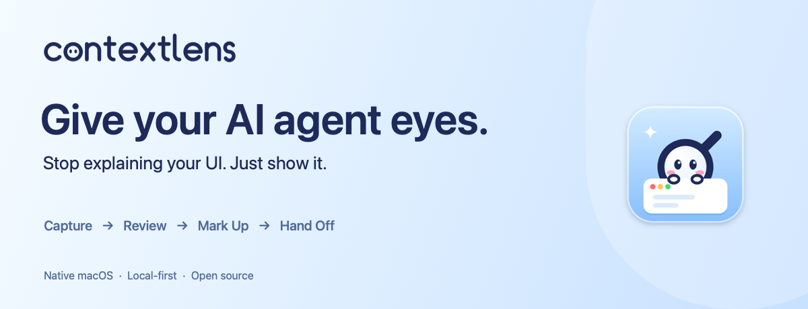
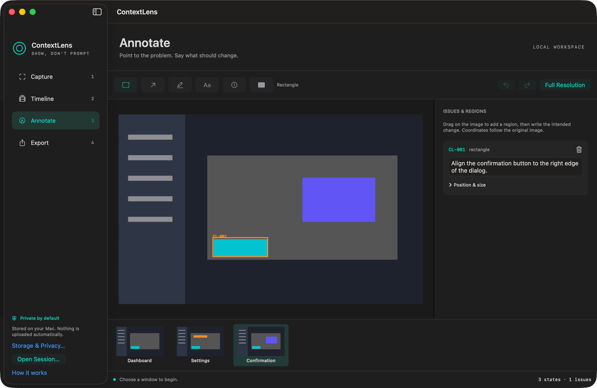
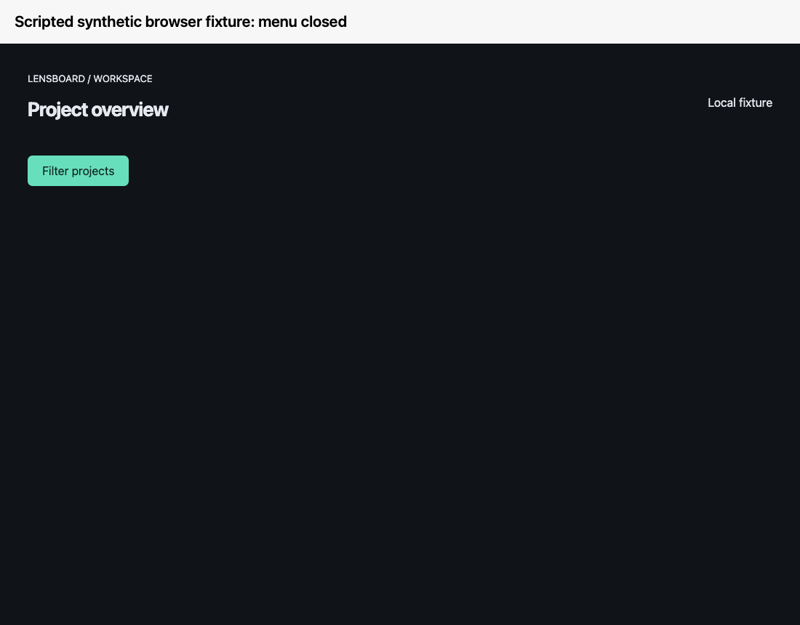
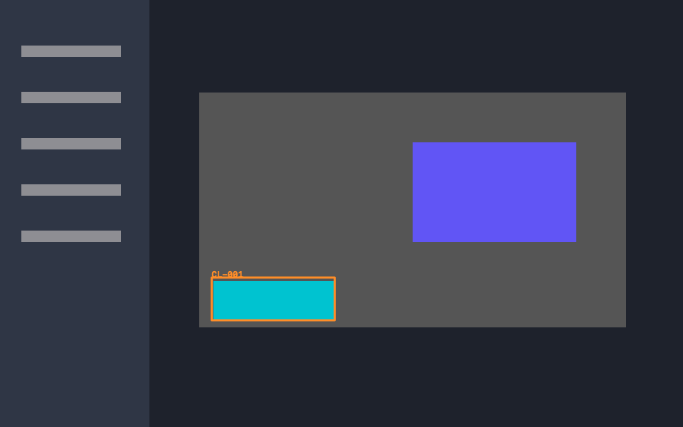
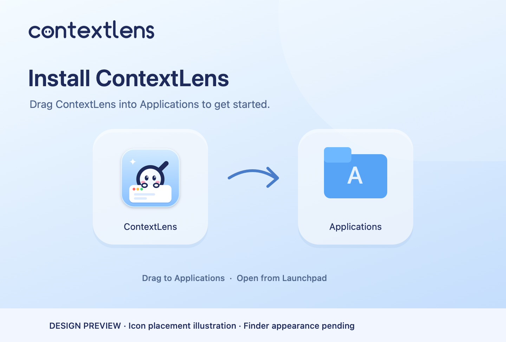

<p align="center">
  
</p>

<p align="center">
  <a href="https://github.com/Brendan-Lim/ContextLens/releases/tag/v0.3.0-preview.1"><strong>Download for macOS · Preview</strong></a>
  &nbsp; · &nbsp; <a href="#install"><strong>Install with Homebrew</strong></a>
  &nbsp; · &nbsp; <a href="LICENSE">MIT open source</a>
</p>

# ContextLens — Give your AI agent eyes.

**Stop explaining your UI. Just show it.**

Capture your interface, mark what needs changing, and hand clear visual instructions to your coding agent. ContextLens brings screenshots, issue notes and useful UI states together so you can spend less effort preparing visual feedback for **Codex, Claude Code or another coding agent**.

Native macOS · Apple Silicon · macOS 14+ · Local-first · No required cloud account

> **Available now: unnotarized preview, for controlled testers.** The download above is `v0.3.0-preview.1`. The `0.3.1` source candidate and its new DMG are being prepared; the official release remains blocked on [isolated interactive acceptance](docs/beta-acceptance.md). Ad-hoc signing does not mean Apple has verified the app.



*Actual earlier native editor with synthetic content; a historical workflow illustration. The current app uses Review, Mark Up and Hand Off tabs. This image is not verification of the 0.3.1 candidate or first-run capture.*

## Your UI feedback shouldn't need an essay.

You see a button that needs moving. Then comes the explanation: which dialog, which button, where it sits, what “a little to the right” means. Screenshots pile up. The next iteration loses the reference from the last one.

ContextLens keeps the visual reference beside your request. Point to the problem, write the change, and export an organized handoff for the agent working in your project.

## Capture → Review → Mark Up → Hand Off

| Step | What you do | What you keep |
|---|---|---|
| **Capture** | Choose one application window and interact with it. | UI states from that selected window. |
| **Review** | Keep the useful states; rename and reorder them. | A focused visual sequence. |
| **Mark Up** | Box or highlight the element, then describe the change. | Separate notes with stable issue IDs such as `CL-001`. |
| **Hand Off** | Save the package and copy its prompt into your coding agent. | Context Markdown, annotated images, crops and metadata. |



*Short synthetic browser-fixture illustration, not a native app recording. [Storyboard and real-demo status](docs/demo-storyboard.md). A real capture-to-Hand-Off walkthrough is pending isolated acceptance.*

## From “that button” to a clear request

You notice a misaligned confirmation button in a web app. Capture its window, mark the button and write:

> Align this button with the right edge of the dialog.

Your agent receives your words alongside the marked visual reference. This [generated example package](docs/examples/agent-session-v2/context.md) uses the equivalent instruction “Align the confirmation button to the right edge of the dialog.” Its images and files are actual fixture export output:

<p align="center">
  
</p>

| File | What the agent gets |
|---|---|
| [`context.md`](docs/examples/agent-session-v2/context.md) | User instructions and visual references. |
| [`annotated/CL-001.png`](docs/examples/agent-session-v2/annotated/CL-001.png) | The marked screenshot. |
| [`crops/CL-001.png`](docs/examples/agent-session-v2/crops/CL-001.png) | A focused view of the issue. |
| [`manifest.json`](docs/examples/agent-session-v2/manifest.json) | Stable IDs, image paths and metadata. |

The fixture above preserves an earlier version-2 layout. Current exports start with a self-contained brief and group multiple marks into one overview per state; [format details](docs/export-format.md) explain both.

## Built for visual feedback

| Capability | How it helps |
|---|---|
| **Selected-window capture** | Bind capture to the window you choose. There is no display or substitute-window fallback. |
| **Meaningful UI states** | Settle visual transitions, choose Low or High sensitivity, and take manual snapshots when needed. Tiny or low-contrast changes can still be missed. |
| **Multiple annotated issues** | Use boxes or freehand highlights, individual instructions, stable issue IDs and undo/redo. |
| **Local saved sessions** | Reopen your states and marks, with originals kept separately from annotations. |
| **Portable Hand Off packages** | Share relative image paths, structured context, crops and a manifest with Codex, Claude Code or another agent. |
| **Native macOS workflow** | SwiftUI, ScreenCaptureKit, a floating recording panel and pointer-centered canvas zoom. Zero production dependencies. |

ContextLens prepares context. You choose what to export and when to give it to your agent; it does not run an AI model or change source code automatically. Automated source mapping is an [isolated experiment](Experiments/visual-to-code/README.md), separate from the app.

## Install

### Download for macOS

**Today:** [download the published preview ZIP](https://github.com/Brendan-Lim/ContextLens/releases/tag/v0.3.0-preview.1), expand it, move `ContextLens.app` into Applications, and open it there. Requires Apple Silicon and macOS 14+.

**Coming with the official release:** open the DMG, drag ContextLens onto Applications, eject the disk, then launch from Applications. There is no public stable DMG yet.

<p align="center">
  
</p>

*Installer design preview with illustrated icons, not a Finder screenshot. The actual DMG contains a draggable app and a functional `/Applications` shortcut. [Packaging and visual verification status](docs/official-release-preparation.md).*

### Homebrew · Preview

```sh
brew install --cask Brendan-Lim/tap/contextlens-preview
```

The preview remains available. The official `contextlens` cask will follow a verified, published stable release; it is not installable yet. [Channel status, verification and migration](docs/homebrew.md).

### First launch and permissions

These free builds are **ad-hoc signed and unnotarized**. They have no Developer ID certificate or Apple trust claim. Verify the release origin and SHA-256 before deciding to authorize. If macOS blocks launch, follow [Apple's Open Anyway instructions](https://support.apple.com/en-us/102445): try opening, then use **System Settings → Privacy & Security → Open Anyway** and confirm **Open** if you choose to proceed. Keep macOS security enabled; managed Macs may prohibit authorization.

Grant Screen Recording to the copy you run, then relaunch when requested. Optional Accessibility access adds clicked-control labels; it never reads typed characters or text-field values. [Permissions](docs/permissions.md) · [Troubleshooting](docs/troubleshooting.md).

## Your context stays yours

Capture is local-first, from a window you select. There are no automatic uploads, no required ContextLens cloud account and no automatic AI execution. You control exported context and where it goes.

**Screenshots can contain sensitive visible information.** Review your images and notes before sharing. Local sessions retain originals; exported redactions are burned into derived images. Sessions save under `~/Library/Application Support/ContextLens/Sessions/` by default. The mascot menu provides **Open Session** and **Storage & Privacy**. [Privacy details](docs/privacy.md) · [Security policy](SECURITY.md).

## For the next round of UI polish

Use ContextLens for frontend bug reports, CSS and layout adjustments, responsive interface iteration, feedback on prototypes, or the small visual changes that are cumbersome to describe. It is for engineers, indie developers and students working with AI coding agents who want their feedback organized around what they can see.

Reducing repetitive screenshot and prompt preparation is the product goal. Human effort savings have not been measured, and earlier experiments did not establish consistent token, model runtime or overall task-time improvements. [Research and measurement limits](docs/research.md).

## Build, test and contribute

Source builds require Xcode with Swift 5.10+ on Apple Silicon:

```sh
git clone https://github.com/Brendan-Lim/ContextLens.git
cd ContextLens
scripts/build-app.sh
scripts/verify.sh
dist/contextlens-cli --help
```

Open `dist/ContextLens.app` when ready. macOS 14 deployment metadata is checked; actual macOS 14 runtime remains unverified. Hosted checks use macOS 15, with local engineering checks on macOS 26.6.2.

The CLI can generate a demo session, validate sessions and export using the same production logic:

```sh
dist/contextlens-cli demo /tmp/my-lens-session
dist/contextlens-cli validate /tmp/my-lens-session
dist/contextlens-cli export /tmp/my-lens-session /tmp/my-lens-export
python3 scripts/validate_package.py /tmp/my-lens-export
```

[Build guide](docs/building.md) · [Architecture](docs/architecture.md) · [Export format](docs/export-format.md) · [Agent integration](Integrations/claude-code.md) · [Native testing](docs/native-testing.md) · [Release preparation](docs/official-release-preparation.md)

ContextLens is **[MIT licensed](LICENSE)**, including its repository-owned branding. [Contributions are welcome](CONTRIBUTING.md); [report a reproducible issue](https://github.com/Brendan-Lim/ContextLens/issues). Review the [publication security checks](docs/publication-security.md) before sharing screenshots or evidence.
