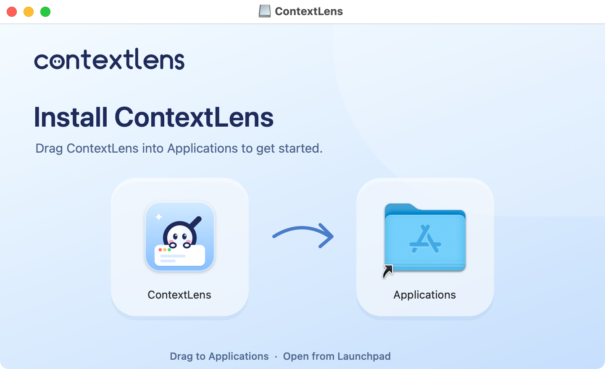

# ContextLens Finder installer

The selected **Twin Glass** design is a 720 × 440 point icy-blue surface with two translucent wells, the owned ContextLens wordmark, a restrained directional curve and a short footer. Composition B uses one continuous glass tray. Both were rendered and visually inspected; separate wells give each real icon more definition.

<picture>
  <source media="(prefers-color-scheme: dark)" srcset="../../docs/media/screens/E-dmg-dark.png">
  
</picture>

| Element | Geometry in Finder points, from top left |
|---|---|
| Window content | 720 × 440; initial origin (160, 120) |
| App icon center | (214, 254) |
| Applications center | (506, 254) |
| Real icon size | 104; labels below, 13 point |
| Background | 720 × 440 and 1440 × 880 representations, combined TIFF |

`assets/background.png` is the chosen 2× artwork; `background@1x.png` is 1×; `composition-b.png` is the alternative. The background has **no app or Applications icons**. The genuine Finder screenshots above show the installed layout. The renderer can also produce an optional labeled design proof in a new output directory; no diagrammatic folder is included in the disk background. Only the real app and `/Applications` symlink supply Finder icons.

## Build and verify

Requires macOS, Xcode native tools, Python 3.9+ and two **build-only MIT** dependencies: [ds-store](https://github.com/dmgbuild/ds_store) 1.3.1 and [mac-alias](https://github.com/dmgbuild/mac_alias) 2.2.2. Exact wheels are hash-pinned in `requirements.txt`; neither enters the app or disk image.

```sh
python3 -m venv .build/dmg-python
.build/dmg-python/bin/python -m pip install --require-hashes -r distribution/dmg/requirements.txt
CONTEXTLENS_SIGN_IDENTITY=- scripts/build-app.sh --output .build/dmg-build
.build/dmg-python/bin/python distribution/dmg/build-dmg.py \
  .build/dmg-build/ContextLens.app /tmp/ContextLens-local.dmg
.build/dmg-python/bin/python distribution/dmg/verify-dmg.py \
  /tmp/ContextLens-local.dmg --app .build/dmg-build/ContextLens.app
```

Choose a fresh output path. Development images are local engineering artifacts, not accepted official releases. Official candidates use [the separate gated workflow](../../docs/official-release-preparation.md).

`build-app.sh` combines the unchanged 1× and 2× artwork into `ContextLens.app/Contents/Resources/InstallerBackground.tiff` **before signing**, for every build channel. Both ZIP and DMG contain that same signed bundle. The DMG builder never adds resources to or re-signs an existing app; rebuild an older bundle before packaging it with this builder.

The builder verifies the original bundle, copies with `ditto`, adds a real `/Applications` symlink, creates an HFS+ UDRW staging image, and mounts it at a unique canonical `/private/tmp` path with `-nobrowse -noautoopen`. It writes only that volume's `.DS_Store`, whose background alias references the TIFF inside the app package, detaches it, and converts to read-only UDZO (zlib level 9). Final promotion uses an exclusive hard link, so even a concurrent build cannot overwrite published bytes.

The exact root inventory is `ContextLens.app`, `Applications` and `.DS_Store`. Verification rejects any other entry, including `.background`, `.metadata_never_index`, loose artwork and indexing directories. `.DS_Store` holds Finder's required layout metadata; Finder does not display it even with Show Hidden Files enabled. The old empty `.metadata_never_index` marker was redundant for this read-only disk image. Apple documents that [disk images are not indexed by Spotlight](https://developer.apple.com/library/archive/documentation/Carbon/Conceptual/SpotlightQuery/Concepts/QueryingMetadata.html). The marker was never inside the app and cannot control indexing of an installed copy.

Validation checks the UDIF checksum (`hdiutil verify`), filesystem (`diskutil verifyVolume`), bundle identity/version/deployment/architecture, strict signature, executable CLI and help, background alias, complete Finder picture settings and icon locations. Finder requires the fallback `backgroundColorRed`, `backgroundColorGreen` and `backgroundColorBlue` fields even with `backgroundType=2`. Omitting them causes Finder to ignore the picture and icon-size settings despite a valid alias. Verification rejects missing or malformed components. A throwaway `ditto` install copy is verified and compared with the original. Inventory comparison includes every file's SHA-256, executable bit and signed resource/Finder metadata. It ignores timestamps and quarantine, which are container/download properties. Attach and detach happen within a cleanup context even on validation failure; a forced detach fallback can target only the unique mount created by that context. No personal volume is searched by name.

## Regenerate the designs

```sh
python3 distribution/dmg/generate-background.py /tmp/contextlens-new-designs
```

`render.swift` draws repository-owned geometry and branding using AppKit and rasterized system typography. Xcode's `pngcrush` optimizes losslessly. No font files or third-party artwork are redistributed. Review both compositions, hero and labeled icon proof before copying them into the repository and adding their reviewed hashes to the publication policy.

## Real Finder checks

See the [hidden-file verification report](../../docs/dmg-hidden-files-verification.md) for the disposable Finder matrix and the separate installed-app discovery investigation.

Metadata verification does **not** verify Finder rendering. On a disposable GUI Mac, open the actual DMG in light and dark appearances, with Show Hidden Files both disabled and enabled, at 1× and Retina where available. Inspect text, precise icons/labels, arrow clearance, window bounds and background sharpness. Drag onto the actual Applications shortcut, eject and launch the installed copy. Restore the disposable environment's original Finder and appearance settings afterward. Record results against the exact candidate hashes using [isolated acceptance](../../docs/beta-acceptance.md). Do not change the owner's settings, overwrite their installation or capture private desktop content.

After capturing only the actual Finder installer window without its shadow, check the rendered artwork as well:

```sh
swift distribution/dmg/verify-finder-background.swift /tmp/Finder-light.png distribution/dmg/assets/background@1x.png
swift distribution/dmg/verify-finder-background.swift /tmp/Finder-dark.png distribution/dmg/assets/background@1x.png
```

The check compares the wordmark, heading, subheading, arrow and footer with the owned artwork, allowing a system titlebar and 1×/2× captures. It excludes the draggable icons and labels. Missing artwork fails even when structural validation succeeds. This pixel check supplements full-resolution inspection; it does not establish icon functionality, installation, security authorization or maintainer acceptance.
