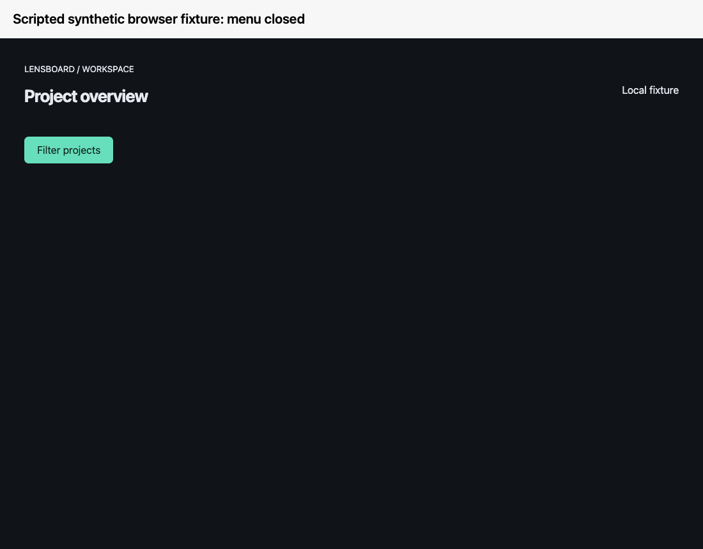

# Synthetic demo storyboard

The public GIF below is a **scripted browser-fixture illustration**: menu closed, menu open, and an example exported annotation. Its inputs are the owned `04` fixture screenshots already used by deterministic replays. It is not a recording of the native ContextLens app or evidence that first-run permissions/capture passed.

Reproduce to a new file with `swift scripts/make-fixture-demo.swift /tmp/new-contextlens-fixture-demo.gif` on macOS. The script reads only repository images; it does not open a browser, capture a desktop or interact with an app. All three generated frames and GIF metadata were inspected before publication.

For a future **real app demo**, record these shots only after [isolated acceptance](beta-acceptance.md) passes:

| Shot | Synthetic content and action | Evidence requirement |
|---|---|---|
| 1 | Show preview label and select the owned menu fixture window | No personal window titles; app version visible |
| 2 | Start capture, open the menu and stop | Continuous real app execution; no fabricated permission result |
| 3 | Review two states and omit the unwanted one | Real state selection, no reconstructed app UI |
| 4 | Box the menu and write “Align the dropdown below its trigger” | Real annotation/note interaction |
| 5 | Save Hand Off into a disposable project folder | Real export, inspect marked crop and `context.md` |
| 6 | Show the copied prompt ready to paste | No agent run or token-savings claim |

Until those shots are recorded, keep them labeled as planned. Keep Gatekeeper and Screen Recording guidance in the accompanying instructions rather than inventing system dialogs for the video. Do not show personal accounts, browser profiles, private projects or permission screens with identifying content.
