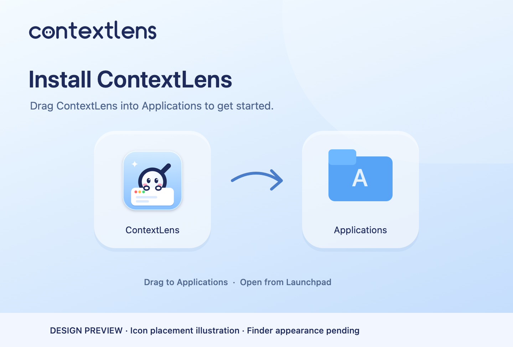

# Official v0.3.1 release preparation — 9 November 2026

**Prepared, not published. READY FOR CONTROLLED TESTERS remains unchanged.** Version 0.3.1/build 6 is still blocked on real first-launch, fresh permissions, selected-window capture/closure and recovery acceptance. This iteration adds a designed installer, a visual README and an explicit official unnotarized channel without changing production application logic or relaxing Developer ID/notarization gates.

## A. DMG design

The selected **Twin Glass** composition uses soft icy-blue gradients, navy system typography, the repository's owned outlined wordmark, two rounded translucent wells, controlled highlights and a flowing directional curve. A second composition uses one continuous glass tray. Both were rendered and inspected; separate wells provide clearer spacing between the functional drag targets.

- Finder content: **720 × 440 points**, initial origin (160, 120).
- Background representations: **720 × 440 at 72 DPI** and **1440 × 880 at 144 DPI**, combined into a hidden multi-resolution TIFF.
- Real Finder icons: **104 points**, centers **(214, 254)** and **(506, 254)**, labels below at 13 points.
- Original sources: `distribution/dmg/render.swift`, `Brand/wordmark.svg`, `Brand/AppIcon.icns`. The existing mascot identity is preserved; no third-party artwork/font files are redistributed.
- Exact assets: `distribution/dmg/assets/background.png`, `background@1x.png`, `composition-b.png`; README hero `docs/media/hero.png`; labeled icon composition `docs/media/installer-preview.png`.

The disk background contains **neither app nor folder icons**. The real app bundle is draggable; a real `/Applications` symlink supplies the destination. The illustration above adds a clearly labeled diagrammatic folder for design review only. It is not the disk background or a Finder screenshot.

Backgrounds, hero, placement illustration and the historical native screenshot were opened and inspected. New media hashes are explicit in the publication policy. ImageIO metadata was inspected; the new images contain dimensions/color information, no source capture metadata or personal identities. The unchanged synthetic GIF keeps its illustration label and earlier approval. The historical native screenshot shows generated geometric content and is explicitly distinguished from the current tabs and untested candidate.

Media review caught a corruption in Xcode's old `pngcrush -reduce` RGBA-to-RGB conversion. The generator now preserves RGBA and compares **every decoded sRGB pixel** with the originals before accepting optimized media. The incorrect outputs were discarded before publication. The final PNGs render correctly and pass container/CRC checks.

**Actual Finder appearance: pending.** No disposable GUI session is available. Metadata checks and the design proof do not establish dark-mode label contrast, actual icon alignment or Finder Retina rendering. These are mandatory acceptance cases.

## B. Packaging

`distribution/dmg/build-dmg.py` uses native `ditto`, `sips`, `tiffutil`, `hdiutil`, `diskutil`, `codesign`, `lipo` and `otool`. It verifies the original app, stages HFS+ UDRW, attaches privately with `-nobrowse -noautoopen`, writes volume-scoped `.DS_Store`, detaches and converts to read-only UDZO. The hidden background has a volume-relative alias. No global Finder preference or normal Applications folder is changed. Temporary mounts use unique canonical `/private/tmp` locations and cleanup on success/failure.

Finder metadata uses **ds-store 1.3.1 / mac-alias 2.2.2**, both MIT, build-only, exact-wheel hash-pinned. There are no new production runtime dependencies. [Reproducible commands and geometry](../distribution/dmg/README.md).

The official packager builds **one signed app**, then creates both ZIP and DMG. It validates ZIP paths/CRC, extracts with `ditto`, verifies signatures/provenance, mounts the DMG, and compares every normalized bundle file SHA-256, executable bit and relevant resource/Finder metadata. Timestamps/quarantine are intentionally excluded from bundle identity. Both containers have independent SHA-256 values. `SHA256SUMS` covers ZIP, DMG and `provenance.json`; provenance records source commit/tree, toolchain, OS, version/build, signing mode and bundle inventory hash.

Local development packaging passed actual filesystem/mount/strict-signature/CLI/background/layout checks and a normal `ditto` install-copy round trip into a temporary directory. The source bundle inventory remained unchanged. Clean official-candidate dual-container results and hashes will be recorded below after the implementation commit; local engineering artifacts are never release acceptance.

Architecture is **arm64**, minimum deployment target **macOS 14.0**. Local checks use macOS 26.6.2; macOS 14 runtime remains unverified. App identity stays `dev.contextlens.app`. No quarantine stripping, Gatekeeper change, TCC reset or installed app replacement occurred.

## C. README

The root README now follows hero → problem → four-step workflow → real fixture output → capabilities → installation → privacy → audience → development/open source. Benefits concern organized visual feedback and less repetitive screenshot/prompt preparation as product goals; no measured effort, token or time saving is claimed. Source mapping remains an isolated experiment, and no autonomous source edits/model execution are promised.

Media is repository-owned and deliberately labeled: branded hero, historical actual native editor with synthetic content, existing synthetic fixture GIF, real generated annotation/package links and installer design proof. The main download links to the actual published `v0.3.0-preview.1`; Homebrew uses the working preview command. DMG instructions are explicitly future availability until the official assets exist.

## D. Official release infrastructure

`.github/workflows/unnotarized-stable.yml` is manual and separate from the unchanged trusted `.github/workflows/release.yml` and preview workflow.

1. **prepare** requires clean current main and an unused version, runs CI, builds with `--unnotarized-stable`, verifies both formats and uploads a 30-day candidate artifact. It cannot publish a release and has read-only repository Contents permission.
2. A person tests **those exact bytes** on a disposable interactive Mac. The [pending template](release-acceptance/template.json) must be replaced by an actually observed, reviewed `docs/release-acceptance/0.3.1.json`. That file deliberately does not exist today.
3. **promote** requires an explicit typed confirmation, the original successful official prepare run and a committed complete acceptance record. Evidence must match source, build, both asset hashes and bundle inventory. Every required native/Finder case must pass with an observation and evidence locator; unresolved blockers stop publication. It verifies source ancestry and rechecks packages without rebuilding.
4. Only then can it create tag `v0.3.1` and draft **ContextLens v0.3.1**, upload immutable assets, redownload/verify them and publish. Previously used tags/releases/assets cannot be overwritten. Failed publication requires deliberate inspection, not clobber/retry.

Signing is **ad-hoc, unnotarized, no Developer ID**. Release notes disclose this and Apple's normal user-controlled Open Anyway procedure. Human evidence remains a maintainer attestation, not something unit tests can prove. [Full procedure](release-acceptance/README.md).

The stable cask updater's explicit `--unnotarized-official` path requires the actual published stable release, both verified packages, acceptance, provenance and source-tag identity. Only then does it render the real ZIP checksum/API asset ID with architecture/OS requirements, app and embedded CLI artifacts, preview conflict and honest caveats. There is no installable stable cask or invented checksum. The default updater still enforces Developer ID, stapling and Gatekeeper. Preview bytes and cask are preserved. [Migration instructions](homebrew.md) require quit/save/backups and deliberate uninstall of only the preview cask, preserving sessions and exports.

## E. Tests and observed results

Local host: Apple Silicon, macOS **26.6.2 (25G83)**. No live model calls, personal-window recording or native fixture launches were used.

| Category | Result and repeatable command |
|---|---|
| Baseline Swift | **106 tests passed**, `scripts/verify.sh` |
| Coverage map | Passed in baseline, `python3 scripts/check-coverage-map.py` |
| Benchmark Python | **49 passed**, baseline `scripts/verify.sh` |
| Packages / independent schemas | **13 validated**, including Draft 2020-12 validation |
| Deterministic production replay | **10 passed** |
| Publication/release/Python regressions | **51 tests**, `python3 -m unittest discover -s scripts/tests -v`; final run recorded before commit |
| Additional experiment Python | **4 + 8 passed**, `python3 -m unittest discover -s Experiments/visual-to-code/tests -v` and equivalent `Experiments/code-aware-efficiency/tests` |
| Node unit/export/mapper | **16 passed**, `node --test Experiments/visual-to-code/tests/unit.test.mjs Experiments/visual-to-code/tests/export.test.mjs Experiments/code-aware-efficiency/tests/mapper.test.mjs` |
| Owned browser fixtures | **10 defects reproduced / 10 controls passed**, `CHROMIUM_EXECUTABLE='/Applications/Google Chrome.app/Contents/MacOS/Google Chrome' node Benchmarks/runners/verify-fixtures.mjs` |
| Optimized native build | Passed, `CONTEXTLENS_SIGN_IDENTITY=- scripts/build-app.sh --output .build/official-preparation` |
| Portability rejection / CLI aliases | Passed, `python3 scripts/verify-release-build.py --app .build/official-preparation/ContextLens.app` |
| Development ZIP / extracted signature / CLI | Passed, `python3 scripts/release.py package .build/official-preparation/ContextLens.app .build/official-zip-check --development` |
| Actual DMG mount / filesystem / UDIF checksum / detach | Passed, `.build/dmg-python/bin/python distribution/dmg/build-dmg.py .build/official-preparation/ContextLens.app .build/official-preparation/ContextLens-0.3.1-arm64.dmg` |
| Actual temporary install-copy / signature | Passed within DMG verification; normal app copy into a throwaway folder |
| Cask templates | Ruby + semantic checks passed; no stable install/fetch possible before publication |
| Tap guard regressions | **19 passed**; current preview cask unchanged |
| Public staged/current/history audits, links, independent Gitleaks | Final audited-index and post-commit results recorded below |
| Actual Finder window, light/dark, drag-to-Applications/eject/launch | **Pending isolated interactive Mac** |
| Real Gatekeeper / Open Anyway / fresh Screen Recording | **Pending isolated interactive Mac** |
| Real selected-window capture/closure/app exit, annotation/Hand Off/recovery/pending-save behavior | **Pending isolated interactive Mac** |

Initial native mount attempts were sandbox-blocked; permitted private mounts subsequently succeeded. The browser initially could not bind loopback under the sandbox; the permitted headless owned-fixture run passed. Installer integration checks caught incorrect Python record/path type comparisons and a noncanonical mount alias path before final bytes were accepted. Cleanup ran on those failures. No failed check is being counted as acceptance.

## F. Remaining blockers

The complete [beta acceptance matrix](beta-acceptance.md), including the existing unresolved live closure diagnostic, remains pending. Specifically: genuine quarantined first launch and user-controlled authorization, fresh permission deny/grant/relaunch, Low/High selected-window capture, Review/annotation/undo/redo, UI Hand Off, reopen/recovery, closure without substitution, target-app exit, ContextLens exit during capture, correct pending-frame persistence and failed-save/retry. Inspect the real Finder window in light/dark modes and complete the genuine drag/install/eject/launch flow. Runtime macOS 14 and mixed-display checks remain unproven.

Automated mounting/copying is packaging evidence, not native app acceptance. No stable tag, GitHub Release or installable stable cask will be published in this iteration. After acceptance, generate/push the actual cask from the published ZIP and verify Homebrew style, online audit, fetch, clean installation/CLI/uninstall on disposable infrastructure. Upgrade needs another genuinely verified release.

## G. GitHub results

Implementation and independent tap-preparation commits, pushed branch SHAs and CI URLs are recorded after verified publication of source. The existing preview is [v0.3.0-preview.1](https://github.com/Brendan-Lim/ContextLens/releases/tag/v0.3.0-preview.1). No new binary release is claimed.
